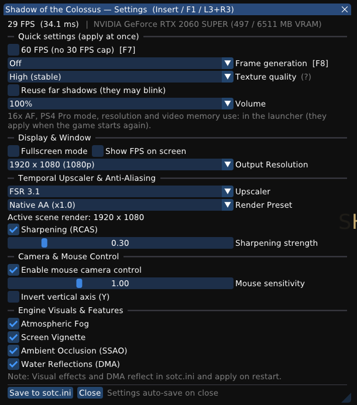

# Shadow of the Colossus — PC native port · v0.74.1

[Releases](../../releases) · [Changelog](CHANGELOG.md)

> [!CAUTION]
> *⚠️*No game or Sony files are included.** You need your own game dump and, for sound, two
> modules from your own console. This project is not affiliated with Sony Interactive
> Entertainment or Bluepoint Games.

> [!CAUTION]
> ⚠️ **Install the game on an SSD, NVMe if you can.** Every new area streams hundreds of MB of
> textures and models from the game folder; on a hard disk the area changes stutter far more and
> can freeze for seconds. Put the game dump (and, ideally, the port's folder) on an SSD.

---

**Status: the game can be finished from start to end** (v0.60.3: played through the last
colossus, the ending and the credits, with high quality textures, PS4 Pro mode and 60 FPS on).

A native Windows port of the PS4 **Shadow of the Colossus** (Bluepoint, 2018; CUSA08809 EU 1.01 or
CUSA08034 US 1.00) for **Windows 10/11**. The game's own x86-64 code runs directly on the PC's CPU and the PS4 GPU
is translated to Vulkan. It is not a full emulator: it is a loader with the system functions the
game needs, in the style of [bloodborne_pc](https://github.com/Supermedo/bloodborne_pc).

### What's new

| Version | Improvements and fixes |
|---|---|
| **0.74.1** | **Launcher updates fixed:** the launchers of v0.73 and v0.74 looked for updates in Oussama268's fork (its release address came in with the opt13 merge) and never offered a new version. They now check this repository again. **Download v0.74.1 by hand once**; later versions update from the launcher. |
| **0.74** | **Lighter draw thread:** Lukto02's draw-thread fast paths (#308) for depth-only and G-buffer draws: when no render register, image or state changed since the last draw, the render target setup, render pass start and dynamic state are reused (99% hit rate in the open world, 0 differences in verify mode). In the user's open-world rides the game stays at 60 FPS 40–50% of the time (23–32% before). **DLSS-G 3x/4x/6x and Dynamic** frame generation multiplier (RTX 50; #314). **Thread priorities on 4-thread CPUs** (#312). |
| **0.73** | **Optimized build** (ThinLTO + PGO trained on the open world): FPS matches or beats Oussama268's fork. **Dynamic FPS** on by default in the 60 FPS mode (below 50 FPS it locks to a steady step that suits the screen: 48 at 144 Hz, 40 at 120 Hz, 30 at 60 Hz, and goes back to 60). **Oussama268's 0.72.1-opt13 merged** (less riding stutter, render target reuse, freeze and black textures fixed, DLAA). **Extreme mode sharp again** (Maximum mip 0, High mip 1). **Stability:** the ending, the intro skip and the Time Attack mosaic fixed (heap guard shortcuts off again), a frozen-picture fix, crash 0x564d24 fixed. Window title with the port version and play time. |
| **0.72.2** | **Ending fixed:** no stretched textures or flicker at the end of the game and no close between the ending and the intro (textures the game freed while drawing them keep their contents for 400 frames). **Smoother area changes:** High/Maximum textures back at mip 2, area-change memory releases without a full GPU wait, and with 24 GB of RAM or more new textures read by the GPU straight from the game's memory. **Large textures get memory of their own** (no more 1.8 GB held empty after an area change). **Updating clears the shader cache once.** Window title with the port version and the play time. |
| **0.72.1** | **Cards with less than 8 GB of video memory get a light profile automatically:** Maximum textures at mip 1 (without the 3 s bank linger, with the page pool safety switch), High at mip 2 as in 0.71, video memory use capped at Default, no staging reserve in video memory. 8 GB cards and up keep everything. **"Card memory" in the launcher's quick settings** (Play page): Automatic (by the card), Light or Full. |
| **0.72** | **Improvements the 0.71 page pool fix made safe, now on by default:** fast GPU readbacks (~25% more FPS at the Shrine), sharper textures (finer mips: High mip 1, Maximum mip 0, with measured mips) and Maximum keeping texture banks 3 s, the heap guard shortcuts. **New upscaler: AMD FSR 4.1** (official AMD FSR SDK 2.4, Vulkan; FSR 4.1 on Radeon RX 6000/7000/9000, FSR 3.1 on other cards; experimental). **Play modes keep the grass as on PS4.** Fewer stutters at area changes (staging reserve, texture copies with fewer page faults), the right video memory budget on integrated GPUs, launcher fixes. |---|---|
| **0.71** |
🔧 Critical Fixes & Performance

• No More Texture Mosaics & Crashes: Fixed a critical memory bug where the game's 64 KiB page pool freed pages twice, causing textures and the heap to conflict. Tested through every Time Attack colossus on Maximum settings with zero crashes and perfect textures.
• Stutter Reduction: Smoother transitions between areas thanks to optimized staging buffers and a rebuilt shader cache.
• Visual Cleaning: Native motion blur is now disabled by default to fix the "shadow trail" artifact in dark areas. Optimized DLSS with Preset E and a current-frame bias for sharper imagery. Includes HUD-less frame generation by default.
• Experimental HDR10: Added a new experimental HDR10 output mode for the base SDR game.

🎮 All-New Custom Launcher

Redesigned with a Shadow of the Colossus aesthetic (night stone, golden typography, and reactive sword-light highlights) inspired by the bloodborne_pc launcher.
• Play Modes: Quick presets for Normal, Pro, Extreme (60 FPS, max textures, extended grass/shadow distance, DLSS), and Custom.
• First-Time Setup Guide: A thematic 5-step hardware wizard that benchmarks your PC (CPU, GPU, RAM, Storage) and picks your ideal play mode.
• Advanced Save Manager: Import/export your progress via .zip or shadPS4, with manual and automatic backups upon game close or crash.
• Quality of Life: Global settings search (Ctrl+F), an interactive controller button tester, multi-monitor selection, a one-click bug report tool, and a dedicated help section. |
| **0.70-opt12** | **Much less stutter:** frames are shown at an even rhythm (tabnul's flip pacer; frame-time jitter 5.2 → 1.2 ms), **in 60 FPS mode too** (no more 17/25 ms judder below 60), hitches over 100 ms down from 15 to 2 per 5-minute demo, worst frame 194 → 113 ms, **no more 900 ms freezes from the v0.70 shader cache** (it translated thousands of shaders again every session), stale or colored small textures fixed, Shrine 40 → 43.5 FPS. Everything from v0.70. The shader cache is rebuilt on first start. |
| **0.70** | **Area changes no longer drop to near zero FPS** (worst frame 534 ms → 58–75 ms, no forced loading screens; 1–6 frames are still lost per change), **fix for a rare crash in the game's allocator after a load** (`0x49800`), **DLSS no longer shakes** in PS4 Pro mode at 30 FPS, **the HUD stays still with frame generation** on FSR 1, a cheaper LOD feedback, new draw thread diagnostics. **Install the game on an SSD.** |
| **0.60.6-C3** | Fix for the C2 stamina bar with DLSS (wide screens, and 16:9 outside PS4 Pro mode); the 30 FPS cap holds in PS4 Pro mode too. |
| **0.60.6-C2** | **Widescreen health and stamina bars fixed** (21:9 / 32:9, #301), **controller vibration toggle** (launcher and in-game menu, #292), **more FPS at the Shrine** (Lucas-blip-png's barrier change), **frame generation without the interface** (no shaking text, experimental), **DLSS Ultra Performance**. |
| **0.60.6-C1** | **Community release.** tabnul's **page allocator fix** (an hour in Maximum + PS4 Pro without a crash, far less colour garbage after loads), **Maximum textures in PS4 Pro mode** (experimental), **NVIDIA DLSS** for RTX 20 and newer (tabnul; here also in PS4 Pro mode and at 4K), **grass** distance/height/detail live in the in-game menu (tabnul), the **US release CUSA08034** (NathanMBR), fixes for weak CPUs and GTX 10xx (JihedMrouki), Oussama268's readback and bind work (new "More FPS" option), **F7: 30 → 60 → unlimited**, a launcher **Debug** page (debug menu on F6 / Start+Select, skip the logos). |
| **0.60.6-opt11** | **US version (CUSA08034) supported** (same eboot as EU 1.01; own saves and shader cache), **+25% FPS at the Shrine and steadier frame times** (speculative GPU readbacks back on, now with a safety check and per-page locking, so no rainbow textures), descriptor binds reused by default, grass, HDR and DLSS menu fixes, logo skip, low-memory warning in the launcher, shader cache file check and invariant positions (GTX 10xx). The shader cache is rebuilt on first start. Riding stutter is still there. |
| **0.60.6** | **No more rainbow garbage on textures and far fewer "closed out of nowhere" crashes** (the cause: speculative GPU readbacks written over memory the game had reused, after loading a save or a new area), **no more black dots on sandy ground**, **in-game menu cleaned up** (FPS, upscaler and sharpening now change at once; Bloodborne leftovers removed), **hard disk read-ahead** (fewer stalls in new areas on HDDs), textures refreshed on every load, a readable session event log (`user/events.log`). |
| **0.60.5** | **Texture quality selector: Off / High / Maximum** (#235: sharp again), **memory leak fixed** (~60 MB/min, long-session stutter), **+3% average and +12% minimum FPS** (descriptor binds reused), **loading after a GPU driver update: 106 s → 7 s**, possible fix for **white characters on AMD GCN** (RX 470–590, Vega), **4-thread CPUs** no longer stuck loading, a hang watchdog, short hitches no longer flash a black loading screen, code review fixes. |
| **0.60.4** | **No more cyan blocks on stone or blinking flowers** with high quality textures (the 0.60.3 crash protection switched the texture detail every second or two; now with hysteresis). |
| **0.60.3** | **The game can be finished from start to end** (played from the last colossus through the ending and credits): fix for the high quality textures crash in wide views (#186), fix for the crash on the load after the credits, +2.7% FPS at the Shrine. |
| **0.60.2** | **Quick settings in the in-game menu** (60 FPS, frame generation, high quality textures, far shadows, volume: apply at once and are kept), **the mouse works in the menu**, **animated loading screen while the shaders are prepared** at start. |
| **0.60.1** | **In-game menu** (Insert / F1 / L3+R3: FPS, GPU and VRAM, fullscreen, resolution, sharpening, mouse camera, effects), **Bloodborne leftovers removed** (~11,700 lines), the game exe has the SotC icon. |
| **0.60** | **Textures on GTX 10xx**, no title-screen hang, **starts on low-memory PCs**, **60 FPS through the game's own Performance mode** (right physics), **each copy has its own `user` folder**, +6% FPS at the Shrine, FSR 3 without black tiles on RX 7000. |
| **0.59.1** | **Far shadows no longer blink** (AMD and NVIDIA; new launcher option), **AMD stripes** on shadows and water fixed, Intel fixes, the log shows the GPU and driver. |
| **0.59** | **More FPS** (Oussama268's fork: draw thread, shaders translated in parallel; bridge 30 → 37–40 FPS), **fix for the ending and save-load crash** (still being tested: report in the issues), **F11 fullscreen**, **video memory use** and **volume** options, launcher **self-update**, ultrawide with PS4 Pro mode, fixes for 6 GB cards and Chinese Windows. |
| **0.58.1** | **High quality textures** (sharp leaves and rocks; the game had not streamed its high resolution versions since 0.0.13) and the **game window's own icon** (or the game's, or a picture of yours). |
| **0.58** | **Community release** (Lucas-blip-png, Gabriell-os, Oussama268, jownatan, xeodeo, nakaionyt/y7ngboy, tabnul): **fewer crashes** (out of video memory, game freezing, post-colossus crash in PS4 Pro mode), **+15% FPS** and less video memory, AMD fixes (RDNA3/4 black tiles), **21:9/32:9 widescreen**, **FPS 30/60/unlimited**, **Xbox button icons**, FSR 3 / DLSS-G frame generation (experimental), launcher in Spanish, Chinese, Korean and Russian. |
| **0.57** | **AMD cards:** fix for the green/pink fog and characters (AMD now uses the NVIDIA 32-lane path; diagnosis from issue #7, not yet tested on an AMD card). **New launcher option** to turn off direct memory access: ~10% more FPS, flatter distant water. |
| **0.56** | **Open-world water with waves:** lakes and rivers below the waterfalls are no longer flat as a mirror (a shader instruction, `S_WQM_B64`, was ignored). **The upper lake ripples and reflects far away** (direct memory access on by default, as in Pink-shadPS4). Distant trees without "colored garbage". |
| **0.0.13** | **No more crashes:** fixed the 0.0.12 crash in the intro/menu (the game asked for more textures than its pool holds). Tested ~40 min across the map with two save loads. **Lake reflections** over almost the whole surface, with ripples (a shader loop guard cut the reflection rays short). |
| **0.0.12** | **Sharp textures back, without crashes:** fixed the memory corruption that closed the game after loading a save, and texture streaming is back (much sharper rocks and walls). **Water:** splashes, rings and foam while swimming; the lake reflects the sky and the sun's glint; environment reflections use each probe's correct cubemap (fix from Pink-shadPS4). |
| **0.0.11** | Fixed the "colored garbage" grass texture of 0.0.10. |

Full details in the [CHANGELOG](CHANGELOG.md) (in Portuguese).

### In-game menu and shortcuts

Press **F1** (or **Insert**, or **L3+R3** on the controller) while playing. The mouse is free while
the menu is open; **Esc** or F1 closes it.



- **Quick settings (apply at once):** FPS (30 / 60 / unlimited), upscaler (FSR 1 / bilinear),
  sharpening (RCAS), frame generation, **texture quality**, far shadow reuse, volume. They are
  also saved as the launcher's choice for the next start.
- **Display:** fullscreen, FPS counter.
- **Camera & mouse:** mouse camera on/off, sensitivity, invert Y.
- The header shows FPS, frame time, the GPU and its video memory in use. Output resolution,
  effects (fog, vignette, SSAO), 16x AF, PS4 Pro mode and video memory use stay in the launcher
  (they apply when the game starts).

| Key | What it does |
|---|---|
| **F1** / Insert / L3+R3 | Opens or closes the in-game menu |
| **F7** | 30 FPS cap on/off (60 FPS without the cap) |
| **F8** | Frame generation: off → DLSS-G → FSR 3 (when the GPU supports it) |
| **F10** | Performance overlay (FPS and frame time) |
| **F11** | Window / fullscreen |

### Texture quality

In the launcher (**Quick settings → Textures**) and in the in-game menu (changes at once):

| Level | What it does | Possible problems |
|---|---|---|
| **Off** | The game's 256×256 versions only (the behaviour before 0.58.1). | Blurry ground, rocks and leaves. For GPUs short of video memory. |
| **High (stable)** — default | The game streams its high resolution textures. When the game's texture memory runs low, the textures ask for a coarser level so the game frees space before it runs out. | A little less sharp in large, wide areas (the game's texture memory is almost always full there, so it stays on the coarser level; #235). |
| **Maximum (sharp)** | High resolution textures always, without that protection. | It **may close the game in very wide views** (sword raised against the sun, the Shrine, the last colossus' area; fault `0x1a371`, #186), mostly in **PS4 Pro mode**. Not seen in our 5–10 minute runs, but reported before. If it happens, go back to **High**. Uses more video memory. |

### Known issues

- The first start after updating rebuilds the shaders: the first load is slow and stutters.
- **Texture quality "Maximum"** can close the game in very wide views (sword raised against the
  sun, the last colossus' area; #186). In PS4 Pro mode it is experimental since 0.60.6-C1 (with
  tabnul's page allocator fix): an hour without a crash in our test, but some colour garbage can
  still show in the 7th and 8th colossus' areas after several visits.
- **Frame generation (FSR 3) with DLSS:** text and HUD may shake; best left off.
- The first start after an update rebuilds the GPU driver's shader cache: about 2 minutes of
  loading screen, and short stalls the first time each area is visited.
- **AMD GCN** cards (RX 470–590, Vega, APUs on the legacy driver): characters and Agro may glow
  white (#152, #158, #187). 0.60.5 adds the LDS barriers these cards were missing (PR #205), which
  is the likely fix: please report whether it helps. `SOTC_AMD64_LDS=0` turns it off.
- **60 FPS:** since 0.60 the game targets 60 FPS itself (its PS4 Pro Performance mode), which
  should fix the 60 FPS physics (the 2nd colossus' wall, colossi "flying"); still being tested
  there. `SOTC_MODES=af16` in the extra variables goes back to the old mode.
- **Frame generation** (experimental): the health/stamina bars may shake (`SOTC_FG_HUDLESS=1`
  tries a HUD-less image), and it only matters at 30 FPS.
- With 8 GB of video memory or less, pick a lower **Video memory use** level if the game runs out.

### Download and use

1. Download `SotC-PC.zip` from [Releases](../../releases) and unzip it into a folder.
2. Run **`SotC.exe`**. On first start the launcher searches the PC's drives for:
   - the game folder (the CUSA08809 or CUSA08034 dump with `eboot.bin`, `sce_module` and `sce_sys`);
   - the sound modules (`libSceNgs2.sprx` and `libSceUlt.sprx`) of an installed shadPS4
     (`user/sys_modules`), which it copies to the port's data folder;
   - a shadPS4 save of the game, which it offers to import;
   - the game's DLCs, if any (shadPS4's `addcont` folder, or a folder with one subfolder per DLC).
3. Check the **Game and saves** page. The **game library** works like shadPS4's.
4. Click **PLAY**.

Requirements: Windows 10/11 64-bit and a **Vulkan 1.3** GPU (NVIDIA, AMD or Intel with a recent
driver). No Python install needed. **The game folder should be on an SSD** (NVMe best): on a hard
disk new areas stutter much more.

| What | Where from | What for |
|---|---|---|
| CUSA08809 (EU 1.01) or CUSA08034 (US 1.00) game dump | your PS4, through GoldHEN | the game |
| decrypted `libSceNgs2.sprx`, `libSceUlt.sprx` | your PS4 (`/system/common/lib/`, GoldHEN FTP), or shadPS4's `user/sys_modules` | sound (silent without them) |

The patch modes (60 FPS, 16x filtering) apply to EU 1.01 and US 1.00 (the same executable);
other versions run at 30 FPS. Each release keeps its own saves (`user/savedata/1/<title ID>`),
and only DLC of the same region is used.

### Launcher features

Game library and automatic search, shadPS4 save import, 720p–4K output (the game renders at
1080p, upscaled with FSR 1 + RCAS), PS4 Pro mode, 60 FPS and 16x AF modes, controller support
(DualShock 4, DualSense, Xbox) with mouse camera, key remapping, Bluepoint engine cvars, desktop
shortcut and a session log in `user/last_run.log`.

In 60 FPS mode the title-screen attract demo averages ~67 FPS on an RTX 2060 SUPER, with
29–34 FPS in its heaviest section. Vulkan only (no DirectX). AMD and Intel can enable the
NVIDIA-only submission options under **Image and FPS > GPU work submission**.

**Why no sound files?** The two `.sprx` files are Sony firmware and may not be redistributed;
the launcher finds and copies yours automatically. **The game closed by itself?** Open an issue
with `user/last_run.log`.

---

## Building

Windows with [MSYS2](https://www.msys2.org/) (CLANG64); packages:
[packaging/windows/README.md](packaging/windows/README.md). To freeze `SotC.exe`: a Windows
Python with PyInstaller and Pillow (`WINPYTHON`).

```
bash build.sh                              # out/bb-probe.exe
bash packaging/windows/package_sotc.sh     # dist/SotC-PC.zip
```

Packaging refuses any `.sprx`/`.prx`: Sony firmware never goes into the package. Test tools:
`tools/`. Diagnostic variables: [docs/sotc/README-SotC.md](docs/sotc/README-SotC.md).

## Credits

- [bloodborne_pc](https://github.com/Supermedo/bloodborne_pc) (Supermedo, deadinside28 and
  forks): loader, native runtime and launcher. Original README: [docs/bbport](docs/bbport/README.md).
  The launcher's look (`launcher/sotc_theme.py`) comes from its 1.9 launcher theme, with the
  [Cinzel](https://github.com/NDISCOVER/Cinzel) and [Inter](https://github.com/rsms/inter) fonts
  (SIL Open Font License).
- [shadPS4](https://github.com/shadps4-emu/shadPS4) and the shadPS4 SotC fork: Vulkan video core.
- [Pink-shadPS4](https://github.com/luizgustavs/Pink-shadPS4) (luizgustavs): culling cvars, BPE
  heap guard, periodic submission, command recording thread, shader fixes (fetch-shader
  constants, `V_ALIGNBIT`, `V_CVT_PK_U8_F32`), dynamic T# tables (`dynamic_tsharp_array_size`),
  the LOD statistics approach and direct memory access for SotC.
- Community pull requests and forks: **Oussama268**, **Lucas-blip-png**, **Gabriell-os**,
  **jownatan**, **xeodeo**, **nakaionyt / y7ngboy**, **tabnul**, **EdouardSence**, **Einar**,
  **KingJhoss**, **nosekefik**, **raulbezerro-dev** and everyone who reports issues with logs.
- 60 FPS patch: illusion (GoldHEN cheats).

License: **GPL-2.0-or-later** ([LICENSE](LICENSE)).
