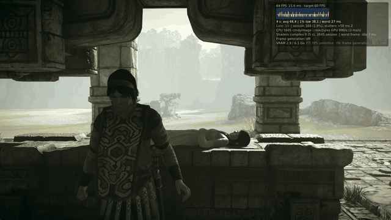
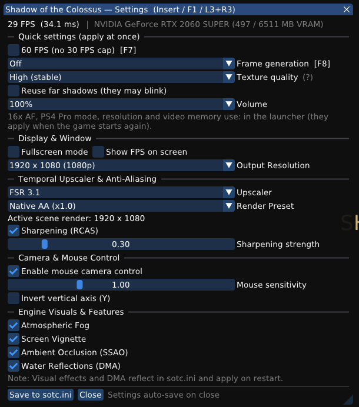

# Shadow of the Colossus — PC native port · v0.60.6-plus5

**The original 0.60.6, plus CPUs without BMI1 (pre-Haswell), CPUs with 4 threads, 120 Hz
fullscreen, a 32-lane fix for AMD GCN cards (RX 470–590, to test), and the FSR 3.1 and DLSS 4.5 upscalers (NVIDIA RTX).** Everything in [AjncSystem's 0.60.6](https://github.com/AjncSystem/ShadowOfTheColossus-PC)
(the game can be finished from start to end; the in-game menu with quick settings; textures on
GTX 10xx cards, 60 FPS through the game's own 60 FPS mode, faster heap guards, HUD-less frame
generation as an option, no crash with high quality textures and the smaller readback window, all
from this fork; the title-screen hang fix, low-memory PCs, a `user` folder per copy), with this
fork's work on top.



What it adds:
- **The Shrine of Worship at 59-61 FPS uncapped** on a Ryzen 7 5700X with an RTX 5060 Ti (it was 53-54 on the same
  PC): image barriers no longer cut the render passes ~20,000 times a second (0.60.6-plus5). The original 0.60.6 runs
  the same scene at ~42 FPS with its safe defaults.
- **CPUs without BMI1/LZCNT/MOVBE** (Intel before Haswell: 2nd/3rd generation Core, Xeon E3 v1/v2;
  AMD FX), which got "This CPU is not supported": the game's ~5,000 such instructions are replaced
  by equivalent routines at startup, only on those CPUs (Oussama268), also in code reached only
  through jump tables (a hang on the first loading screen on a real one). AVX is still required.
  Confirmed on a real one (issue #88 of the original: played up to the first colossus).
- **CPUs with 4 threads** (4 cores without SMT, 2 cores with SMT): two of the port's GPU threads no
  longer spin on a core while they wait, so the game's threads get it. A Ryzen 7 held to 4 logical
  processors stayed stuck loading the attract demo; now it runs at 76 FPS (60 FPS mode). With more
  than 8 logical processors nothing changes (sent to the original as
  [PR #198](https://github.com/AjncSystem/ShadowOfTheColossus-PC/pull/198)).
- **AMD GCN cards (RX 470–590, Vega), to test:** white, flickering characters and smoke and fog
  colours that change every run. These cards run the shaders 64 wide. The port now lowers them to 32
  lanes where the driver requires a 32-lane compute subgroup (`GPU: AMD wave32 on` in the log;
  `SOTC_AMD_WAVE32=0` turns it off, `=1` forces it), and the LDS barriers are on for 64-wide AMD
  (`SOTC_AMD64_LDS=0` turns them off). On an RX 570 on Windows the flicker went away. **Open:** some
  GCN runs stop with a lost GPU device right after the first colossus (issues #187, #123 and #41 of
  the original). If that happens to you, try `SOTC_AMD_WAVE32=0` and send `last_run.log`.
- **Fullscreen at 120 Hz** on 144/165 Hz monitors, so every frame stays on screen as long (Anthonypc23).
- The launcher's self-update follows this fork's releases; the launcher no longer stops when its
  console refuses writes (issue #104).

**[⬇ Download the latest release](../../releases/latest)** · bring your own game dump · Windows 10/11, Vulkan 1.3

---

## Roadmap

Public plan for this fork, updated as work lands (last update: 24/10/2026). Issue numbers refer to
the original repository.

**Part 1: upscalers (more FPS on weaker GPUs, sharper 1440p/4K output)**
- [x] FSR 1 with RCAS (in place since 0.60.x)
- [x] Phase 0: rendering below 1080p works with the game's own patches (23/10: Shrine, 3840x2160 output with FSR 1:
      1080p 38.7 FPS, 720p 46.9, 576p 49.7; clean image, no device lost)
- [x] Phase 1: the temporal inputs (depth, motion vectors, jitter, camera) are captured without frame generation
- [x] Phase 2: FSR 3.1 temporal upscaler, off by default (`SOTC_UPSCALER=fsr3`, with `SOTC_RENDER_RES` below 1080p and
      `SOTC_OUTPUT_RES`; 23/10: Shrine 720p to 4K, clean image, ~48 FPS like FSR 1; HUD still goes through it)
- [x] Phase 3: launcher option (upscaler FSR 3.1 + quality preset) and the in-game F1 menu switch
- [~] Phase 4: DLSS Super Resolution through Streamline, NVIDIA only (`SOTC_UPSCALER=dlss`): code in place and
      falls back to FSR 3.1 without the DLLs (checked 23/10); NOT tested with the real `sl.dlss.dll` and
      `nvngx_dlss.dll`, which are not in the repository and must be put next to bb-probe.exe
- [x] Phase 5: documentation (CHANGELOG, this roadmap)

**Part 2: up to 120 FPS in game, without frame generation**
- Where we are (25/10, 0.60.6-plus5): the Shrine of Worship runs at 59-61 FPS uncapped (it was ~42 on 0.60.6 and
  53-54 before the barrier change); descriptor reuse and hot readbacks are on by default again. 120 FPS means 8.3 ms.
- [x] T0: ceiling measured 23/10 (0.60.6 + this fork, 1080p, safe defaults): attract demo 71.2 FPS average (min 48.4,
      draw thread busy 13-14 ms per frame); Shrine 41.6 FPS (draw thread ~20 ms). M1 needs 100, M3 needs 60
- [x] T1: the game clock follows real time: in the attract demo the camera covers the same path in the same real
      seconds at 30 FPS (capped), 74.6 FPS (60 FPS mode) and 71.7 FPS with a 240 Hz vblank. Physics and animation
      above 60 FPS are not checked yet (needs a frame rate above what the PC reaches today)
- [x] T2b (25/10, 0.60.6-plus5): the limit was not the CPU but render passes cut by barriers. Every use of a written
      1920x1080 R32Uint storage image (GENERAL layout) after its previous use made a barrier, and a barrier inside a dynamic
      render pass ends it (~22k `EndRendering` a second, 98% from `FlushBarriers`). The barrier is now issued once per
      fence epoch (first use after an EOP/ReleaseMem label), as on GCN, where the game orders UAV writes itself.
      Shrine 59.2 and 60.9 FPS against 54.0 and 53.0 (interleaved runs); save walks of 400 s and 600 s, 0 faults.
      `SOTC_GENERAL_SYNC=0` turns it off. Also in plus5: partial async readbacks (+1.3 FPS), `SOTC_DEPTH_RO`.
      Measured and dropped on the way: a second Vulkan queue for async compute (compute is 10-20% of GPU time), engine
      cvars, thread affinity, spinning mutexes (contention gone, FPS unchanged), GPU clocks.
- [ ] T2: reduce CPU work per draw: skip repeated register state, make the fast descriptor reuse safe,
      move pure precomputation off the render thread; splitting the render thread is the last resort
- [~] T2 so far: `SOTC_FAST_BIND=1` (descriptor reuse, 59% hits) gives +7% in the Shrine (45.3 and 43.9 FPS against
      42.3 and 41.0, 24/10). It stays off: its fix (`mem_epoch`) still needs a check on sandy ground in the open
      world, which the scripted save walk does not reach. Players can try it with `SOTC_FAST_BIND=1`.
      Moving work to the command processor thread (24/10 profile of the draw thread, Shrine): binding resources is
      43% of it (textures 19%, buffers 15%) and depends on cache state that only that thread owns; the host
      page protects it issues cost 1.6 ms per frame (14,800 calls/s, `SOTC_PROTECT_STATS=1`); pure precomputation
      (user data, sharps, hashes) is a few percent. Not worth the risk of stale textures.
      Found instead: 4 video memory allocations and 4 frees per frame (the driver wants dedicated memory for
      images), ~5% of the draw thread. An image pool removes them: Shrine 40.3 to 42.0 FPS (+4%), attract demo
      71.2 to 75.5 (+6%), same video memory use, `SOTC_IMAGE_POOL=0` turns it off.
      Tried and dropped (24/10, Shrine, two runs each): making the draw thread the biased owner of the texture
      cache lock gave 40.8 / 40.9 FPS against 43.1 / 43.8 with the old owner (-5%); one atomic per 64-page word in
      `SetSrtReadProtectedPages` is within noise (43.0 over four runs), kept because it is equivalent and cheaper.
      What is left in the draw thread is the CPU-GPU traffic of the scene itself, per frame: 45 readbacks (~10% of
      the time, 6% waiting on the GPU), 230 guest write faults, 108 uploads (11.7 MB, the `memmove`) and 737 page
      protects (6%). Each is the tracking that keeps the game's memory and the GPU's in step, so cutting it means
      changing what is tracked, not how fast it runs. Tried on that traffic (24/10): half of the guest read
      faults (28,600 of 55,000 over a run) hit bytes the GPU never wrote, on pages that share them with game
      objects (`SOTC_RB_STATS=1`, `SOTC_RB_STATS_CODE=1` dumps the code around each reader); finishing such a load
      from the backing without a readback removed 60% of those faults and changed nothing (42.9 / 40.8 against
      43.7 / 41.9), so it was dropped. `SOTC_RB_EARLY=0` (43 early submits a frame) is the same: 42.6 / 41.9
      against 43.1 / 42.0. The Shrine does not move with any single piece of this traffic.
      A split of the draw thread was measured earlier at 6.7% of its time (no-go). The other T2 items are each
      expected to give a few percent, so the Shrine at 60 FPS (+44%) is not in reach by these alone.
- [~] T3 (plus5): the barrier change passed two save walks and two screenshots; the open-world sand check and a long soak are still open
- [ ] T3: every change must pass the rainbow-noise and sand-dot checks before it becomes default
- [ ] T4: 120 Hz presentation options in the launcher and the in-game menu
- Milestones (M3 reached 25/10 with 59.2-60.9 FPS in the Shrine, uncapped; the minimum over 15 s was 58.9-60.3, so "stable" is borderline): M1 attract demo ≥ 100 FPS · M2 open world ≥ 90 · M3 Shrine ≥ 60 stable with safe
  defaults · M4 Shrine 90 · M5 all scenes up to 120. Each one is marked only with a measured number.

**Open items from the 0.60.6 release**
- [ ] GCN cards: some runs end with a lost GPU device after the first colossus (issues #187, #123, #41).
      The 32-lane change is not the cause; the event log from 0.60.6 is needed to continue.
- [ ] FSR 1 on RDNA4 (#208, #209): fix in 0.60.5-plus3 not yet confirmed on hardware.
- [ ] Upstream pull requests #198, #205 and #207: content already in 0.60.6; open decision on closing them.

---

## Roteiro (português)

Plano público deste fork, atualizado conforme o trabalho avança (última atualização: 25/10/2026).
Os números de issue se referem ao repositório original.

**Parte 1: upscalers (mais FPS em GPUs mais fracas, saída 1440p/4K mais nítida)**
- [x] FSR 1 com RCAS (já presente desde a 0.60.x)
- [x] Fase 0: renderizar abaixo de 1080p funciona com os ajustes do próprio jogo (23/10: Santuário, saída 3840x2160 com FSR 1:
      1080p 38,7 FPS, 720p 46,9, 576p 49,7; imagem limpa, sem perda de dispositivo)
- [x] Fase 1: as entradas temporais (profundidade, vetores de movimento, jitter, câmera) são capturadas sem geração de quadros
- [x] Fase 2: upscaler temporal FSR 3.1, desligado por padrão (`SOTC_UPSCALER=fsr3`, com `SOTC_RENDER_RES` abaixo de 1080p e
      `SOTC_OUTPUT_RES`; 23/10: Santuário 720p para 4K, imagem limpa, ~48 FPS como o FSR 1; a interface também passa por ele)
- [x] Fase 3: opção no launcher (upscaler FSR 3.1 + preset de qualidade) e a troca no menu F1 do jogo
- [~] Fase 4: DLSS Super Resolution via Streamline, só NVIDIA (`SOTC_UPSCALER=dlss`): código pronto, cai no FSR 3.1
      sem as DLLs (verificado em 23/10); NÃO testado com as `sl.dlss.dll` e `nvngx_dlss.dll` de verdade, que não
      ficam no repositório e precisam estar ao lado do bb-probe.exe
- [x] Fase 5: documentação (CHANGELOG, este roteiro)

**Parte 2: até 120 FPS no jogo, sem geração de quadros**
- Onde estamos (25/10, 0.60.6-plus5): o Santuário de Culto roda a 59-61 FPS sem limite (eram ~42 na 0.60.6 e 53-54
  antes da mudança das barreiras); o reaproveitamento de descritores e as leituras quentes voltaram a ser padrão.
  120 FPS significam 8,3 ms.
- [x] T0: teto medido em 23/10 (0.60.6 + este fork, 1080p, padrões seguros): demo de atração 71,2 FPS de média (mínima
      48,4, thread de desenho ocupada 13-14 ms por quadro); Santuário 41,6 FPS (thread de desenho ~20 ms). M1 pede 100, M3 pede 60
- [x] T1: o relógio do jogo segue o tempo real: na demo de atração a câmera percorre o mesmo caminho nos mesmos segundos
      reais a 30 FPS (travado), 74,6 FPS (modo 60) e 71,7 FPS com vblank de 240 Hz. Física e animação acima de 60 FPS
      ainda não foram conferidas (precisa de uma taxa que este PC ainda não alcança)
- [x] T2b (25/10, 0.60.6-plus5): o limite não era a CPU, e sim os passes de renderização cortados por barreiras. Cada
      uso de uma imagem de armazenamento 1920x1080 R32Uint escrita (layout GENERAL) depois do uso anterior gerava uma
      barreira, e uma barreira dentro de um passe dinâmico o encerra (~22 mil `EndRendering` por segundo, 98% vindos do
      `FlushBarriers`). A barreira agora sai uma vez por época de fence (primeiro uso depois de um rótulo EOP/ReleaseMem),
      como no GCN, onde o próprio jogo ordena as escritas em UAV. Santuário 59,2 e 60,9 FPS contra 54,0 e 53,0 (execuções
      intercaladas); roteiros de save de 400 s e 600 s, 0 falhas. `SOTC_GENERAL_SYNC=0` desliga. Também na plus5: leituras
      de volta assíncronas parciais (+1,3 FPS) e `SOTC_DEPTH_RO`. Medido e descartado no caminho: segunda fila Vulkan para
      compute assíncrono (compute é 10 a 20% do tempo da GPU), cvars do motor, afinidade de threads, mutex com espera ativa
      (a contenção sumiu e o FPS não mudou), clocks da GPU.
- [ ] T2: reduzir o trabalho de CPU por desenho: pular estado de registradores repetido, tornar seguro o
      reaproveitamento de descritores, mover pré-cálculo puro para fora da thread de desenho; dividir a
      thread de desenho é o último recurso
- [~] T2 até agora: `SOTC_FAST_BIND=1` (reaproveitar descritores, 59% de acertos) dá +7% no Santuário (45,3 e 43,9 FPS
      contra 42,3 e 41,0, 24/10). Continua desligado: a correção dele (`mem_epoch`) ainda precisa de uma checagem
      em chão de areia no mundo aberto, que a caminhada automática do save não alcança. Quem joga pode testar com
      `SOTC_FAST_BIND=1`. Dividir a thread de desenho foi medido antes em 6,7% do tempo dela (inviável). Os outros
      itens do T2 devem dar poucos por cento cada, então o Santuário a 60 FPS (+44%) não vem só deles.
      Achado no lugar: 4 alocações e 4 liberações de memória de vídeo por quadro (o driver quer memória dedicada
      para imagens), ~5% da thread de desenho. Um pool de imagens as elimina: Santuário 40,3 para 42,0 FPS (+4%),
      demo de atração 71,2 para 75,5 (+6%), mesmo uso de memória de vídeo, `SOTC_IMAGE_POOL=0` desliga.
      Testado e descartado (24/10, Santuário, duas rodadas cada): tornar a thread de desenho a dona privilegiada da
      trava do cache de texturas deu 40,8 / 40,9 FPS contra 43,1 / 43,8 com a dona antiga (-5%); uma atômica por
      palavra de 64 páginas em `SetSrtReadProtectedPages` fica dentro do ruído (43,0 em quatro rodadas), mantida por
      ser equivalente e mais barata. O que sobra na thread de desenho é o tráfego CPU-GPU da própria cena, por
      quadro: 45 readbacks (~10% do tempo, 6% esperando o GPU), 230 faltas de escrita do jogo, 108 uploads (11,7 MB,
      o `memmove`) e 737 proteções de página (6%). Cada um é o rastreamento que mantém a memória do jogo e a do GPU
      em dia, então reduzir é mudar o que se rastreia, não a velocidade com que roda. Testado nesse tráfego
      (24/10): metade das faltas de leitura do jogo (28.600 de 55.000 numa rodada) cai em bytes que o GPU nunca
      escreveu, em páginas que os dividem com objetos do jogo (`SOTC_RB_STATS=1`; `SOTC_RB_STATS_CODE=1` despeja o
      código em volta de cada leitor); terminar essa leitura pelo backing, sem readback, tirou 60% dessas faltas e
      não mudou nada (42,9 / 40,8 contra 43,7 / 41,9), então saiu. `SOTC_RB_EARLY=0` (43 envios antecipados por
      quadro) é igual: 42,6 / 41,9 contra 43,1 / 42,0. O Santuário não se mexe com nenhuma peça isolada desse tráfego.
      Mover trabalho para a thread do processador de comandos (perfil de 24/10 da thread de desenho, Santuário): ligar
      recursos é 43% dela (texturas 19%, buffers 15%) e depende de estado dos caches que só ela possui; as proteções
      de página que ela pede custam 1,6 ms por quadro (14.800 chamadas/s, `SOTC_PROTECT_STATS=1`); o pré-cálculo puro
      (dados de usuário, sharps, hashes) é poucos por cento. Não compensa o risco de texturas velhas.
- [~] T3 (plus5): a mudança das barreiras passou em dois roteiros de save e duas capturas de tela; a checagem da areia no mundo aberto e um soak longo continuam pendentes
- [ ] T3: cada mudança precisa passar pelos testes de ruído colorido e de pontos pretos antes de virar padrão
- [ ] T4: opções de apresentação a 120 Hz no launcher e no menu do jogo
- Marcos (M3 atingido em 25/10 com 59,2 a 60,9 FPS no Santuário sem limite; o mínimo em 15 s foi 58,9 a 60,3, então "estável" fica no limite): M1 demo de atração ≥ 100 FPS · M2 mundo aberto ≥ 90 · M3 Santuário ≥ 60 estável com os padrões
  seguros · M4 Santuário 90 · M5 todas as cenas até 120. Cada marco só é marcado com um número medido.

**Pendências da versão 0.60.6**
- [ ] Placas GCN: algumas sessões terminam com a perda do dispositivo gráfico após o primeiro colosso
      (issues #187, #123, #41). A conversão para 32 lanes não é a causa; é preciso o log de eventos da 0.60.6.
- [ ] FSR 1 em RDNA4 (#208, #209): correção da 0.60.5-plus3 ainda não confirmada em hardware.
- [ ] Pull requests do original #198, #205 e #207: o conteúdo já está na 0.60.6; decisão pendente sobre fechá-los.

---

[Releases](../../releases) · [Changelog](CHANGELOG.md) · [Roadmap](#roadmap) · [Roteiro](#roteiro-português)

> **No game or Sony files are included.** You need your own game dump and, for sound, two
> modules from your own console. This project is not affiliated with Sony Interactive
> Entertainment or Bluepoint Games.

---

**Status: the game can be finished from start to end** (v0.60.3: played through the last
colossus, the ending and the credits, with high quality textures, PS4 Pro mode and 60 FPS on).

A native Windows port of the PS4 **Shadow of the Colossus** (Bluepoint, 2018; CUSA08809 EU 1.01 or
CUSA08034 US 1.00) for **Windows 10/11**. The game's own x86-64 code runs directly on the PC's CPU and the PS4 GPU
is translated to Vulkan. It is not a full emulator: it is a loader with the system functions the
game needs, in the style of [bloodborne_pc](https://github.com/Supermedo/bloodborne_pc).

### What's new

| Version | Improvements and fixes |
|---|---|
| **0.60.6-plus5** | **Lucas-blip-png fork:** **the Shrine runs at 59–61 FPS uncapped (was 53–54)**: a GENERAL→GENERAL storage-image barrier is now issued once per fence epoch instead of before every draw, so render passes are no longer cut ~20k times a second (`SOTC_GENERAL_SYNC=0` turns it off); partial async readbacks (`SOTC_RB_PARTIAL`); depth sampled as target keeps a consistent layout (`SOTC_DEPTH_RO=0` turns it off); launcher **Report a problem** button (sanitized report: copy, .zip, or a pre-filled GitHub issue; nothing is sent by itself). |
| **0.60.6-plus4** | **Lucas-blip-png fork:** hot readbacks (`SOTC_RB_HOT`) are on by default again: about +14% in the Shrine (rainbow noise and the 0x49500 crash fixed by Oussama268's late checks; 26 min soak, 0 faults); GPU, launcher (HDR, skip logos, grass options, low-memory warning) and US-release (CUSA08034) work from Oussama268's fork. `SOTC_RB_HOT=0` turns it off. |
| **0.60.6-plus3** | **Lucas-blip-png fork:** descriptor reuse (`SOTC_FAST_BIND`) is on by default again: +8% in the Shrine (43.5 → 47.1 FPS) after an independent review fixed the races behind the black dots on sand of 0.60.5; `SOTC_FAST_BIND=0` turns it off. Open-world sand not tested yet. |
| **0.60.6-plus2** | **Lucas-blip-png fork:** **FSR 3.1 and DLSS Super Resolution (DLSS 4.5 model, NVIDIA RTX) upscalers** with the DLAA / Quality / Balanced / Performance / Ultra performance modes in the launcher, a texture LOD bias for them (sharper textures below the output size), images taken from a pool (no video memory allocation per frame: +4% in the Shrine, +6% in the attract demo), and many measured dead ends of the 120 FPS roadmap documented. DLSS needs the NVIDIA DLLs next to the game; without them FSR 3.1 is used. |
| **0.60.6** | **No more rainbow garbage on textures and far fewer "closed out of nowhere" crashes** (the cause: speculative GPU readbacks written over memory the game had reused, after loading a save or a new area), **no more black dots on sandy ground**, **in-game menu cleaned up** (FPS, upscaler and sharpening now change at once; Bloodborne leftovers removed), **hard disk read-ahead** (fewer stalls in new areas on HDDs), textures refreshed on every load, a readable session event log (`user/events.log`). |
| **0.60.5-plus1** | **Lucas-blip-png fork:** the original's 0.60.5 merged into the fork (texture quality selector, memory leak fix, faster loading after a driver update), with the fork's AMD GCN 32-lane path, memory fallback and FSR 1 fixes kept. Not tested on a GCN card with both LDS barriers on yet. |
| **0.60.5** | **Texture quality selector: Off / High / Maximum** (#235: sharp again), **memory leak fixed** (~60 MB/min, long-session stutter), **+3% average and +12% minimum FPS** (descriptor binds reused), **loading after a GPU driver update: 106 s → 7 s**, possible fix for **white characters on AMD GCN** (RX 470–590, Vega), **4-thread CPUs** no longer stuck loading, a hang watchdog, short hitches no longer flash a black loading screen, code review fixes. |
| **0.60.4** | **No more cyan blocks on stone or blinking flowers** with high quality textures (the 0.60.3 crash protection switched the texture detail every second or two; now with hysteresis). |
| **0.60.3-plus6** | **Lucas-blip-png fork:** fixes a crash after the first colossus in Pro-mode saves when Windows refuses the game memory (the fallback tries 8, 7 and 6 GiB first). |
| **0.60.3-plus5** | **Lucas-blip-png fork:** hotfix: the AMD GCN 32-lane conversion is on by default only where the driver requires it (fixes a crash in the intro on Linux RADV). |
| **0.60.3-plus4** | **Lucas-blip-png fork:** **AMD GCN cards (RX 470–590, Vega): the white/green flicker is gone** (confirmed on an RX 570) with the 32-lane conversion on by default there; `SOTC_AMD_WAVE32=0` turns it off. |
| **0.60.3-plus3** | **Lucas-blip-png fork:** fixes two crashes: at boot when Windows refuses the 9152 MiB of game memory (small page file), and with **frame generation on PCs with an AMD and an NVIDIA card**; FSR 1 barriers. |
| **0.60.3-plus2** | **Lucas-blip-png fork:** a fix to test for **AMD GCN cards** (RX 470–590, Vega: white, flickering characters and smoke) and a little more FPS on **CPUs with 4 threads** (+4% on 2 cores with SMT). |
| **0.60.3-plus** | **Lucas-blip-png fork:** all of the original's **0.60.3** (the game can be finished; quick settings in the in-game menu), plus **CPUs with 4 threads** (the GPU threads no longer spin on a core the game needs: from stuck loading to 76 FPS on 4 logical processors), **CPUs without BMI1** and **120 Hz fullscreen**. |
| **0.60.3** | **The game can be finished from start to end** (played from the last colossus through the ending and credits): fix for the high quality textures crash in wide views (#186), fix for the crash on the load after the credits, +2.7% FPS at the Shrine. |
| **0.60.2** | **Quick settings in the in-game menu** (60 FPS, frame generation, high quality textures, far shadows, volume: apply at once and are kept), **the mouse works in the menu**, **animated loading screen while the shaders are prepared** at start. |
| **0.60.1-plus** | **Lucas-blip-png fork:** all of the original's **0.60.1** (which already has this fork's GTX 10xx textures, 60 FPS through the game's own mode, faster heap guards and HUD-less frame generation), plus **CPUs without BMI1** (Oussama268, with the fix for the hang on the first loading screen), **no crash with high quality textures** (0x1a371), a smaller readback window and **120 Hz fullscreen** (Anthonypc23). |
| **0.60.1** | **In-game menu** (Insert / F1 / L3+R3: FPS, GPU and VRAM, fullscreen, resolution, sharpening, mouse camera, effects), **Bloodborne leftovers removed** (~11,700 lines), the game exe has the SotC icon. |
| **0.60** | **Textures on GTX 10xx**, no title-screen hang, **starts on low-memory PCs**, **60 FPS through the game's own Performance mode** (right physics), **each copy has its own `user` folder**, +6% FPS at the Shrine, FSR 3 without black tiles on RX 7000. |
| **0.59-plus5** | **Lucas-blip-png fork:** no more **crash with high quality textures in PS4 Pro mode** (0x1a371: the game filled its own memory pool; now it asks for less detail when the pool is nearly full) and a fix for **CPUs without BMI1** that hung on the first loading screen. |
| **0.59-plus4** | **Lucas-blip-png fork:** 0.59-plus3 on top of the original's **0.59.1**: **AMD stripes** on shadows and water fixed, Intel fixes, a **Far shadows** launcher option, and the log shows the GPU and driver (Oussama268 and AjncSystem). |
| **0.59-plus3** | **Lucas-blip-png fork:** **60 FPS through the game's own 60 FPS mode** (the PS4 Pro Performance one): the game's timing follows 60 FPS, which should fix the bird colossus flying away, the 2nd colossus' wall and weak point damage; F7 switches the game's target between 30 and 60. Textures on GTX 10xx confirmed on a GTX 1080 Ti. |
| **0.59-plus2** | **Lucas-blip-png fork:** 0.59-plus plus **CPUs without BMI1/LZCNT/MOVBE** (2nd/3rd generation Intel Core, Xeon E3 v1/v2, AMD FX; by Oussama268), which could not start the game, **no black tiles on FSR 3 generated frames on AMD RX 7000** (KingJhoss), and the launcher's PLAY button is no longer cut off above 100% display scale. |
| **0.59-plus** | **Lucas-blip-png fork:** all of 0.59, plus **~7% more FPS** in the Shrine (47 → 50.6 FPS: heap guards no longer rebuilt every frame and a smaller readback window), **textures on GTX 10xx cards**, **far shadows that no longer blink**, **120 Hz fullscreen** on 144/165 Hz monitors (Anthonypc23) and frame generation without the HUD as an experimental option (off). The launcher self-update follows this fork's releases. The draw thread and DMA sweep of 0.58.1-plus are now part of the original. |
| **0.58.1-plus** | **Lucas-blip-png fork:** all of 0.58.1, **no crash a minute into a new game** (high quality textures, which cause it, off by default), **far shadows that no longer blink**, **frame generation without the HUD** (FSR 3/DLSS-G) and an update notice in the launcher, plus **~19% more FPS** in the Shrine (42 → 50 FPS, unlimited FPS): a draw thread separate from the command processor, the heap guard no longer rebuilt per readback, a smaller readback window and an incremental DMA sweep. **120 Hz fullscreen** on 144/165 Hz monitors (Anthonypc23). Its own shader cache for PS4 Pro mode. |
| **0.59.1** | **Far shadows no longer blink** (AMD and NVIDIA; new launcher option), **AMD stripes** on shadows and water fixed, Intel fixes, the log shows the GPU and driver. |
| **0.59** | **More FPS** (Oussama268's fork: draw thread, shaders translated in parallel; bridge 30 → 37–40 FPS), **fix for the ending and save-load crash** (still being tested: report in the issues), **F11 fullscreen**, **video memory use** and **volume** options, launcher **self-update**, ultrawide with PS4 Pro mode, fixes for 6 GB cards and Chinese Windows. |
| **0.58.1** | **High quality textures** (sharp leaves and rocks; the game had not streamed its high resolution versions since 0.0.13) and the **game window's own icon** (or the game's, or a picture of yours). |
| **0.58** | **Community release** (Lucas-blip-png, Gabriell-os, Oussama268, jownatan, xeodeo, nakaionyt/y7ngboy, tabnul): **fewer crashes** (out of video memory, game freezing, post-colossus crash in PS4 Pro mode), **+15% FPS** and less video memory, AMD fixes (RDNA3/4 black tiles), **21:9/32:9 widescreen**, **FPS 30/60/unlimited**, **Xbox button icons**, FSR 3 / DLSS-G frame generation (experimental), launcher in Spanish, Chinese, Korean and Russian. |
| **0.57** | **AMD cards:** fix for the green/pink fog and characters (AMD now uses the NVIDIA 32-lane path; diagnosis from issue #7, not yet tested on an AMD card). **New launcher option** to turn off direct memory access: ~10% more FPS, flatter distant water. |
| **0.56** | **Open-world water with waves:** lakes and rivers below the waterfalls are no longer flat as a mirror (a shader instruction, `S_WQM_B64`, was ignored). **The upper lake ripples and reflects far away** (direct memory access on by default, as in Pink-shadPS4). Distant trees without "colored garbage". |
| **0.0.13** | **No more crashes:** fixed the 0.0.12 crash in the intro/menu (the game asked for more textures than its pool holds). Tested ~40 min across the map with two save loads. **Lake reflections** over almost the whole surface, with ripples (a shader loop guard cut the reflection rays short). |
| **0.0.12** | **Sharp textures back, without crashes:** fixed the memory corruption that closed the game after loading a save, and texture streaming is back (much sharper rocks and walls). **Water:** splashes, rings and foam while swimming; the lake reflects the sky and the sun's glint; environment reflections use each probe's correct cubemap (fix from Pink-shadPS4). |
| **0.0.11** | Fixed the "colored garbage" grass texture of 0.0.10. |

Full details in the [CHANGELOG](CHANGELOG.md) (in Portuguese).

### In-game menu and shortcuts

Press **F1** (or **Insert**, or **L3+R3** on the controller) while playing. The mouse is free while
the menu is open; **Esc** or F1 closes it.



- **Quick settings (apply at once):** FPS (30 / 60 / unlimited), upscaler (FSR 1 / bilinear),
  sharpening (RCAS), frame generation, **texture quality**, far shadow reuse, volume. They are
  also saved as the launcher's choice for the next start.
- **Display:** fullscreen, FPS counter.
- **Camera & mouse:** mouse camera on/off, sensitivity, invert Y.
- The header shows FPS, frame time, the GPU and its video memory in use. Output resolution,
  effects (fog, vignette, SSAO), 16x AF, PS4 Pro mode and video memory use stay in the launcher
  (they apply when the game starts).

| Key | What it does |
|---|---|
| **F1** / Insert / L3+R3 | Opens or closes the in-game menu |
| **F7** | 30 FPS cap on/off (60 FPS without the cap) |
| **F8** | Frame generation: off → DLSS-G → FSR 3 (when the GPU supports it) |
| **F10** | Performance overlay (FPS and frame time) |
| **F11** | Window / fullscreen |

### Texture quality

In the launcher (**Quick settings → Textures**) and in the in-game menu (changes at once):

| Level | What it does | Possible problems |
|---|---|---|
| **Off** | The game's 256×256 versions only (the behaviour before 0.58.1). | Blurry ground, rocks and leaves. For GPUs short of video memory. |
| **High (stable)** — default | The game streams its high resolution textures. When the game's texture memory runs low, the textures ask for a coarser level so the game frees space before it runs out. | A little less sharp in large, wide areas (the game's texture memory is almost always full there, so it stays on the coarser level; #235). |
| **Maximum (sharp)** | High resolution textures always, without that protection. | It **may close the game in very wide views** (sword raised against the sun, the Shrine, the last colossus' area; fault `0x1a371`, #186), mostly in **PS4 Pro mode**. Not seen in our 5–10 minute runs, but reported before. If it happens, go back to **High**. Uses more video memory. |

### Known issues

- The first start after updating rebuilds the shaders: the first load is slow and stutters.
- **Texture quality "Maximum"** can close the game in very wide views (sword raised against the
  sun, the last colossus' area; #186). Since 0.60.6 it is not available in PS4 Pro mode, where it
  closed within minutes.
- The first start after an update rebuilds the GPU driver's shader cache: about 2 minutes of
  loading screen, and short stalls the first time each area is visited.
- **AMD GCN** cards (RX 470–590, Vega, APUs on the legacy driver): characters and Agro may glow
  white (#152, #158, #187). 0.60.5 adds the LDS barriers these cards were missing (PR #205), which
  is the likely fix: please report whether it helps. `SOTC_AMD64_LDS=0` turns it off.
- **60 FPS:** since 0.60 the game targets 60 FPS itself (its PS4 Pro Performance mode), which
  should fix the 60 FPS physics (the 2nd colossus' wall, colossi "flying"); still being tested
  there. `SOTC_MODES=af16` in the extra variables goes back to the old mode.
- **Frame generation** (experimental): the health/stamina bars may shake (`SOTC_FG_HUDLESS=1`
  tries a HUD-less image), and it only matters at 30 FPS.
- With 8 GB of video memory or less, pick a lower **Video memory use** level if the game runs out.

### Download and use

1. Download `SotC-PC.zip` from [Releases](../../releases) and unzip it into a folder.
2. Run **`SotC.exe`**. On first start the launcher searches the PC's drives for:
   - the game folder (the CUSA08809 or CUSA08034 dump with `eboot.bin`, `sce_module` and `sce_sys`);
   - the sound modules (`libSceNgs2.sprx` and `libSceUlt.sprx`) of an installed shadPS4
     (`user/sys_modules`), which it copies to the port's data folder;
   - a shadPS4 save of the game, which it offers to import;
   - the game's DLCs, if any (shadPS4's `addcont` folder, or a folder with one subfolder per DLC).
3. Check the **Game and saves** page. The **game library** works like shadPS4's.
4. Click **PLAY**.

Requirements: Windows 10/11 64-bit and a **Vulkan 1.3** GPU (NVIDIA, AMD or Intel with a recent
driver). No Python install needed.

| What | Where from | What for |
|---|---|---|
| CUSA08809 (EU 1.01) or CUSA08034 (US 1.00) game dump | your PS4, through GoldHEN | the game |
| decrypted `libSceNgs2.sprx`, `libSceUlt.sprx` | your PS4 (`/system/common/lib/`, GoldHEN FTP), or shadPS4's `user/sys_modules` | sound (silent without them) |

The patch modes (60 FPS, 16x filtering) apply to EU 1.01 and US 1.00 (the same executable);
other versions run at 30 FPS. Each release keeps its own saves (`user/savedata/1/<title ID>`),
and only DLC of the same region is used.

### Launcher features

Game library and automatic search, shadPS4 save import, 720p–4K output (the game renders at
1080p, upscaled with FSR 1 + RCAS), PS4 Pro mode, 60 FPS and 16x AF modes, controller support
(DualShock 4, DualSense, Xbox) with mouse camera, key remapping, Bluepoint engine cvars, desktop
shortcut and a session log in `user/last_run.log`.

In 60 FPS mode the title-screen attract demo averages ~67 FPS on an RTX 2060 SUPER, with
29–34 FPS in its heaviest section. Vulkan only (no DirectX). AMD and Intel can enable the
NVIDIA-only submission options under **Image and FPS > GPU work submission**.

**Why no sound files?** The two `.sprx` files are Sony firmware and may not be redistributed;
the launcher finds and copies yours automatically. **The game closed by itself?** Open an issue
with `user/last_run.log`.

---

## Building

Windows with [MSYS2](https://www.msys2.org/) (CLANG64); packages:
[packaging/windows/README.md](packaging/windows/README.md). To freeze `SotC.exe`: a Windows
Python with PyInstaller and Pillow (`WINPYTHON`).

```
bash build.sh                              # out/bb-probe.exe
bash packaging/windows/package_sotc.sh     # dist/SotC-PC.zip
```

Packaging refuses any `.sprx`/`.prx`: Sony firmware never goes into the package. Test tools:
`tools/`. Diagnostic variables: [docs/sotc/README-SotC.md](docs/sotc/README-SotC.md).

## Credits

- [bloodborne_pc](https://github.com/Supermedo/bloodborne_pc) (Supermedo, deadinside28 and
  forks): loader, native runtime and launcher. Original README: [docs/bbport](docs/bbport/README.md).
- [shadPS4](https://github.com/shadps4-emu/shadPS4) and the shadPS4 SotC fork: Vulkan video core.
- [Pink-shadPS4](https://github.com/luizgustavs/Pink-shadPS4) (luizgustavs): culling cvars, BPE
  heap guard, periodic submission, command recording thread, shader fixes (fetch-shader
  constants, `V_ALIGNBIT`, `V_CVT_PK_U8_F32`), dynamic T# tables (`dynamic_tsharp_array_size`),
  the LOD statistics approach and direct memory access for SotC.
- Community pull requests and forks: **Oussama268**, **Lucas-blip-png**, **Gabriell-os**,
  **jownatan**, **xeodeo**, **nakaionyt / y7ngboy**, **tabnul**, **EdouardSence**, **Einar**,
  **KingJhoss**, **nosekefik**, **raulbezerro-dev** and everyone who reports issues with logs.
- 60 FPS patch: illusion (GoldHEN cheats).

License: **GPL-2.0-or-later** ([LICENSE](LICENSE)).
